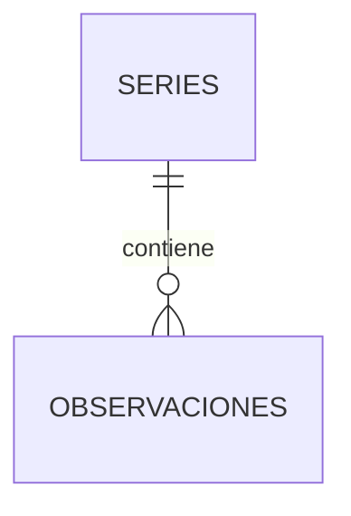
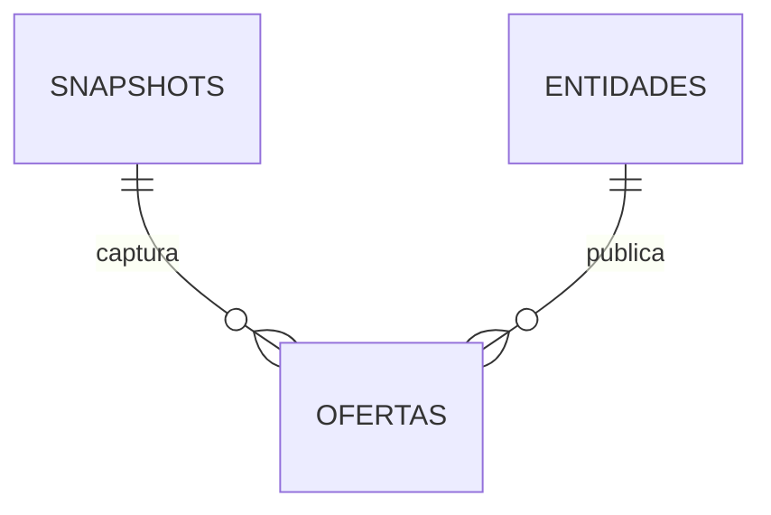
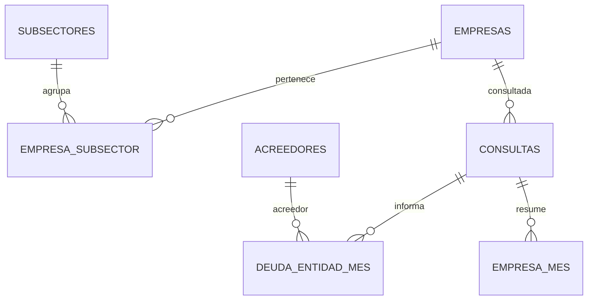

# Diseño relacional y uso de las tablas

Versión documental 2.1 — 5 de octubre de 2026 (Buenos Aires).
Contrato de tablas: 2.0 (sin modificación de columnas ni claves).

Los CSV representan tablas de una futura base relacional. Cada corrida completa
publica un estado consistente de A, B y C. El contrato ejecutable está en
`config/esquema_tablas.json`: columnas, tipos, nulabilidad, claves primarias,
claves foráneas y asignación a índices. Los scripts validan ese contrato antes
de exportar las tablas de cada base; el puntero conjunto se publica solo si las tres terminan.

Esta versión incorpora preparación a precios constantes antes de recalcular
features y modelos. El criterio económico está en `criterios_datos.md`;
las fórmulas de features y el trabajo de ML permanecen en sus documentos.
No se generan matrices de features ni scores sin implementar su consumidor.

## Índices del proyecto

- **ICC:** Condiciones Crediticias y Momentum. Dataset mensual macrocrediticio construido, en la etapa actual, exclusivamente con A y el IPC nacional de INDEC. Base B no alimenta el ICC histórico.
- **IAP:** Atractivo Relativo de Productos Financieros. Dataset por observación de oferta; B es principal y A aporta contexto cuando pueda alinearse temporalmente.
- **IEF:** Estrés Financiero Empresarial. Dataset empresa-mes; C es principal y A puede aportar contexto.

Los tres son productos separados. No se fuerza un join entre poblaciones,
frecuencias y calendarios distintos. No se presume una relación entre empresas
de C y ofertas de B por compartir el nombre de un banco.

## Decisión de alcance: Base B e ICC

**Decisión del 5 de octubre de 2026:** excluir Base B de la construcción,
calibración y evaluación del ICC histórico en esta etapa. Las tres tablas B
se conservan para el IAP y el análisis de ofertas actuales.

Base B se genera a partir de snapshots del Régimen de Transparencia del BCRA.
Una captura contiene las ofertas observadas en ese momento; no reconstruye
las condiciones ofrecidas en meses anteriores. En los archivos revisados hay
13 capturas completas entre el 7 y el 23 de septiembre de 2026. La matriz ICC
real actual tiene meses elegibles entre junio de 2017 y junio de 2026:
no existe solapamiento temporal entre ambas coberturas.

Por lo tanto, no se agregan features B a la matriz ICC histórica, no se
imputan ofertas actuales hacia atrás y no se recorta el historial de A para
forzar una unión. Se continúa acumulando snapshots B para su consumidor IAP.

Una eventual incorporación de B al ICC requerirá una decisión metodológica
explícita, suficiente historia coincidente y un protocolo de comparación
entre ofertas equivalentes por producto, denominación, modalidad de tasa y
beneficiario. La aparición de un primer mes coincidente no basta para
calibrar y evaluar ese componente. Esta posibilidad futura no forma parte
del mapeo de consumidores vigente para el ICC.

## Mapa de tablas y consumidores previstos

| Tabla CSV | Grano / clave primaria | Relación | Índice y uso concreto |
|---|---|---|---|
| `base_a/series` | Una serie; `serie_id` | Padre de observaciones | ICC: selección, unidades, frecuencia y agregación. IAP/IEF: escoger series de contexto. |
| `base_a/deflactor_ipc` | Mes de cierre; `fecha_mes` | Padre compartido de hechos ajustados A/C | ICC/IEF: IPC nacional INDEC y factor 100/IPC. IAP: futuro, sujeto a unidades/fechas. |
| `base_a/observaciones` | Serie-fecha; `serie_id, fecha` | FK a series | ICC: variaciones, tasas, composición y momentum. IAP: tasas de referencia. IEF: contexto macrocrediticio. |
| `base_b/entidades` | Prestador; `codigo_entidad` | Padre de ofertas | IAP: filtros, fichas y evaluación por entidad; análisis de la oferta vigente. |
| `base_b/snapshots` | Captura; `snapshot_id` | Padre de ofertas | IAP: disponibilidad, selección diaria y split temporal; historia de las ofertas capturadas. |
| `base_b/ofertas` | Registro dentro de una captura; `observacion_id` | FK a snapshot y entidad | IAP: costo objetivo y condiciones predictoras; comparador y análisis de ofertas actuales. |
| `base_c/empresas` | Persona jurídica; `cuit_normalizado` | Padre de consultas y pertenencias | IEF: universo, fichas y evaluación por empresa. La selección no depende de su deuda. |
| `base_c/subsectores` | Rubro-subsector; `subsector_id` | Padre de pertenencias | IEF: comparación sectorial y grupos de referencia. |
| `base_c/empresa_subsector` | Pertenencia; `cuit_normalizado, subsector_id` | FK a empresa y subsector | IEF: filtros y comparación entre pares sin convertir pertenencias en empresas distintas. |
| `base_c/acreedores` | Nombre de acreedor fuente; `acreedor_id` | Padre de deuda | IEF: concentración, entradas/salidas de acreedores y drill-down. |
| `base_c/consultas` | Captura-empresa; `run_fuente, cuit_normalizado` | FK a empresa | IEF: elegibilidad, disponibilidad temporal, 404 y auditoría. |
| `base_c/deuda_entidad_mes` | Empresa-mes-acreedor; `cuit_normalizado, fecha, acreedor_id` | FK a consulta y acreedor | IEF: saldos, exposición, concentración, revisión y proceso judicial. |
| `base_c/empresa_mes` | Empresa-mes; `cuit_normalizado, fecha` | FK a consulta | IEF: tabla longitudinal de entrada para lags, cambios, ventanas y score. |

Son **13 tablas**: 3 para A, 3 para B y 7 para C. Las dimensiones adicionales
evitan repetir maestros en cada hecho y permiten validar referencias.
`empresa_mes` es un hecho agregado materializado deliberadamente: tendrá un
consumidor directo de features, y sus saldos se reconcilian con el detalle.

## Relaciones

## Identidad, tipos y tiempo

- CUIT, códigos de entidades e IDs son **texto**; no abrir y volver a guardar con Excel convirtiéndolos a números.
- Las fechas son `YYYY-MM-DD`; las capturas incluyen hora y zona horaria.
- Las claves técnicas usan SHA-256 sobre componentes delimitados por JSON. No se basan en nombres normalizados aproximados.
- `observacion_id` se construye con snapshot, familia y fila del archivo processed inmutable. Identifica una observación, **no un producto persistente entre días**.
- `clave_familia_provisional` y `clave_variante_provisional` conservan las claves previas de B como auxiliares. No son PK ni justifican deduplicar productos distintos.
- `acreedor_id` de C identifica el nombre exacto recibido. Los códigos de B y los nombres de C no se unen automáticamente. Una equivalencia jurídica se verificará solo si un consumidor la requiere.
- La dimensión de entidades B muestra el último nombre observado por código. El nombre original por captura sigue conservado en las fuentes; el nombre no es predictor del modelo inicial.
- Los CSV representan el estado seleccionado de cada corrida. No concatenar corridas completas sin resolver versiones: repetiría observaciones A/B y meses C.
- C exporta una consulta válida del maestro completo, indicada en `run_fuente`. Las revisiones y capturas anteriores permanecen en las fuentes inmutables; una futura base que almacene todas las versiones necesitará incluir `run_fuente` en las PK de los hechos versionados.

## Reglas de interpretación

**A.** Se conservan `valor_original` y `valor_analitico`. Los 41 ceros de la serie
1199 anteriores a junio de 1993 se marcan como excepción y solo el valor analítico
se deja nulo. Los seis stocks ICC 927 y 1145–1149 fueron contrastados por mes con XLS
oficiales: los valores de la API están en millones de ARS, pese al metadato
de miles. `unidad` conserva lo declarado; `unidad_validada` identifica la
escala verificada. Otros stocks no se habilitan automáticamente.
Las unidades y frecuencias provienen de la dimensión de series. Agregar a mes es
una tarea del feature engineering: media de las observaciones disponibles para
series diarias según el catálogo; conservar una observación mensual para series mensuales.
El mes diario abierto se detectará y excluirá antes de comparar períodos completos.

**B.** Solo capturas completas aportan ofertas. La tabla snapshots también
conserva adquisiciones incompletas, sin hechos asociados, para identificar su
exclusión. Familia, denominación y tipo de tasa definen grupos comparables.
Los valores numéricos no interpretables quedan nulos en el hecho; los conteos de
separación se registran en `run_metadata.json`. La fila fuente permite auditarlos.
No se winsoriza ni borra un valor extremo positivo automáticamente.

**C.** Los montos de deuda están en **miles de pesos argentinos**. El panel usa
saldo positivo para riesgo y concentración. `mes_observado=False` implica falta
de observación, no saldo cero. Situación y concentración sin saldo positivo
quedan desconocidas. La revisión y el proceso judicial se agregan sobre entidades
reportadas, aun con saldo cero; si falta información no se convierten a False.
Un 404 preserva a la empresa y su consulta. No fabricar una secuencia de deuda cero
para esa empresa. La pertenencia múltiple no aumenta el universo de 100 CUIT;
los totales de subsectores no pueden sumarse como grupos disjuntos.

## Disponibilidad y validación histórica

`fecha` de A o C es el período del dato; no prueba cuándo fue publicado.
`fecha_captura` de B y C es cuándo se adquirió la fuente, no la publicación
original de cada observación histórica. En A no tenemos vintages ni fechas
históricas de publicación verificadas. En C el histórico se recuperó en una
consulta posterior a sus meses de referencia.

Por ello, el primer backtest de A/C será **retrospectivo por período**, y deberá
declararlo. No presentarlo como una simulación point-in-time de decisiones que
podían tomarse entonces. Las nuevas corridas guardan fecha, fuentes y bases
actualizadas; para producción se usarán solo capturas conocidas a la fecha de
scoring. Una evaluación point-in-time requiere registrar y seleccionar versiones
históricas disponibles, además de usar cortes temporales adecuados.

## Qué dejó de exportarse

| Salida anterior | Tratamiento actual |
|---|---|
| A `historico_analitico`, `catalogo` | Reemplazados por observaciones y series con FK explícita. |
| A `mensual_descriptivo`, `mensual_sin_diarias_abiertas`, `mensual_wide` | Se calcularán en la etapa de features ICC/contexto. No se exportan ahora. |
| A `cotizaciones_disponibles` | Sin exportación: una cotización aislada no permite features cambiarias históricas. La fuente se conserva. |
| B `ofertas_historicas` | Reemplazada por ofertas, entidades y snapshots. |
| B `ofertas_ultimo_snapshot` | Se obtiene filtrando snapshots completos; sin tabla física duplicada. |
| B agregados por estrato/entidad | Se calcularán para features o comparador, con un consumidor concreto. |
| B `inventario_snapshots` | Integrado en snapshots, dimensión usada en filtros y splits. |
| B `valores_no_interpretables` | Conteos en metadata, sin CSV auxiliar. |
| B `sensibilidad_hasta_365_dias` | Diagnóstico del análisis; no se exporta operativamente. |
| C `coverage` | Reemplazada por consultas, con FK y fecha de captura. |
| C `empresa_entidad_mes` | Reemplazada por deuda_entidad_mes y acreedores. |
| C `empresa_subsector_mes` | Se obtiene mediante un join; sin duplicar el panel. |
| C transiciones y matrices | Se calcularán en evaluación/EDA cuando se necesiten. No se exportan ahora. |

Las nuevas adquisiciones C dejan de generar paneles exploratorios, el antiguo target y el bundle ZIP. Solo escriben cuatro insumos processed: maestros de empresas y pertenencias, cobertura y deuda fuente. Las siete tablas de consumo se construyen después, con el contrato relacional.

Los notebooks finales siguen pudiendo recalcular sus vistas explicativas a partir
de las fuentes mediante las funciones compartidas. No son parte del pipeline operativo.

## Migración futura

Una futura migración cargará dimensiones antes de hechos y creará las PK/FK del
contrato. La convención CSV usa UTF-8 con BOM, coma, vacío para nulo y booleanos
True/False. Cada corrida incluye versiones de esquema, hashes de código e insumos
y controles. Los CSV de esta etapa son una base lógica relacional; el validador
de Python hace cumplir sus restricciones, todavía sin transacciones de un motor SQL.

## Diccionario de columnas

La definición ejecutable y su mapeo a índices están en el contrato JSON.

### base_a/series

| Columna | Tipo lógico | Admite nulo | Unidad / regla |
|---|---|---|---|
| `serie_id` | integer | No | PK |
| `concepto` | text | Sí |  |
| `descripcion` | text | No |  |
| `segmento` | text | Sí |  |
| `unidad` | text | No |  |
| `moneda` | text | Sí |  |
| `frecuencia` | text | No | valores: D, M |
| `tipo_valor` | text | Sí |  |
| `nivel_narrativa` | text | Sí |  |
| `agregacion_mensual` | text | Sí |  |
| `nota` | text | Sí |  |
| `validacion_escala` | text | No |  |
| `rol_analitico` | text | Sí |  |

### base_a/observaciones

| Columna | Tipo lógico | Admite nulo | Unidad / regla |
|---|---|---|---|
| `serie_id` | integer | No | PK |
| `fecha` | date | No | PK |
| `valor_original` | number | No |  |
| `valor_analitico` | number | Sí |  |
| `excepcion_precobertura` | boolean | No |  |

### base_b/entidades

| Columna | Tipo lógico | Admite nulo | Unidad / regla |
|---|---|---|---|
| `codigo_entidad` | text | No | PK |
| `nombre` | text | No |  |

### base_b/snapshots

| Columna | Tipo lógico | Admite nulo | Unidad / regla |
|---|---|---|---|
| `snapshot_id` | text | No | PK |
| `fecha` | date | No |  |
| `fecha_captura` | datetime | Sí |  |
| `completo` | boolean | No |  |
| `motivo` | text | No |  |
| `seleccionado_dia` | boolean | No |  |

### base_b/ofertas

| Columna | Tipo lógico | Admite nulo | Unidad / regla |
|---|---|---|---|
| `observacion_id` | text | No | PK |
| `snapshot_id` | text | No |  |
| `codigo_entidad` | text | No |  |
| `familia` | text | No | valores: hipotecarios, personales, prendarios, tarjetas |
| `fila_fuente` | integer | No |  |
| `denominacion` | text | Sí |  |
| `tipo_tasa` | text | Sí |  |
| `clave_familia_provisional` | text | Sí |  |
| `clave_variante_provisional` | text | Sí |  |
| `nombre_completo` | text | Sí |  |
| `nombre_corto` | text | Sí |  |
| `destino_fondos` | text | Sí |  |
| `beneficiario` | text | Sí |  |
| `territorio_validez` | text | Sí |  |
| `segmento` | text | Sí |  |
| `fecha_informacion` | date | Sí |  |
| `antiguedad_dias` | number | Sí |  |
| `tea` | number | Sí | porcentaje anual |
| `cftea` | number | Sí | porcentaje anual |
| `tea_adelanto` | number | Sí | porcentaje anual |
| `monto_min` | number | Sí | según denominacion de la oferta; sin conversión |
| `monto_max` | number | Sí | según denominacion de la oferta; sin conversión |
| `plazo_meses` | number | Sí |  |
| `ingreso_min` | number | Sí | según denominacion de la oferta; sin conversión |
| `antiguedad_laboral_min_meses` | number | Sí |  |
| `edad_max` | number | Sí |  |
| `relacion_cuota_ingreso_pct` | number | Sí | porcentaje |
| `relacion_monto_tasacion_pct` | number | Sí | porcentaje |
| `cuota_inicial` | number | Sí | según denominacion de la oferta; sin conversión |
| `cargo_cancelacion_anticipada` | number | Sí |  |
| `comision_administracion_mantenimiento` | number | Sí |  |
| `comision_renovacion` | number | Sí |  |

### base_c/empresas

| Columna | Tipo lógico | Admite nulo | Unidad / regla |
|---|---|---|---|
| `empresa_id` | text | No |  |
| `rubro` | text | No |  |
| `razon_social` | text | No |  |
| `cuit` | text | Sí |  |
| `cuit_normalizado` | text | No | formato: ^\d{11}$; PK |
| `perfil_sectorial` | text | Sí |  |
| `grupo_economico` | text | Sí |  |
| `estado_seleccion` | text | Sí |  |
| `fuente_consolidacion` | text | Sí |  |
| `documentos_soporte` | text | Sí |  |
| `cuit_formato_valido` | boolean | Sí |  |
| `observaciones` | text | Sí |  |
| `cuit_check_digit_valido` | boolean | Sí |  |

### base_c/subsectores

| Columna | Tipo lógico | Admite nulo | Unidad / regla |
|---|---|---|---|
| `subsector_id` | text | No | PK |
| `rubro` | text | No |  |
| `nombre` | text | No |  |

### base_c/empresa_subsector

| Columna | Tipo lógico | Admite nulo | Unidad / regla |
|---|---|---|---|
| `cuit_normalizado` | text | No | PK |
| `subsector_id` | text | No | PK |
| `documento_soporte` | text | Sí |  |
| `estado_seleccion` | text | Sí |  |

### base_c/acreedores

| Columna | Tipo lógico | Admite nulo | Unidad / regla |
|---|---|---|---|
| `acreedor_id` | text | No | PK |
| `nombre_fuente` | text | No |  |

### base_c/consultas

| Columna | Tipo lógico | Admite nulo | Unidad / regla |
|---|---|---|---|
| `run_fuente` | text | No | PK |
| `cuit_normalizado` | text | No | PK |
| `fecha_captura` | datetime | No |  |
| `intentada` | boolean | No |  |
| `http_status` | integer | No |  |
| `resultado` | text | No | valores: ok, no_data |
| `mensaje` | text | Sí |  |
| `denominacion_empresa_bcra` | text | Sí |  |

### base_c/deuda_entidad_mes

| Columna | Tipo lógico | Admite nulo | Unidad / regla |
|---|---|---|---|
| `cuit_normalizado` | text | No | PK |
| `fecha` | date | No | PK |
| `acreedor_id` | text | No | PK |
| `run_fuente` | text | No |  |
| `situacion` | integer | Sí |  |
| `monto_miles_pesos` | number | No | miles de ARS |
| `en_revision` | boolean | Sí |  |
| `proceso_judicial` | boolean | Sí |  |

### base_c/empresa_mes

| Columna | Tipo lógico | Admite nulo | Unidad / regla |
|---|---|---|---|
| `cuit_normalizado` | text | No | PK |
| `fecha` | date | No | PK |
| `run_fuente` | text | No |  |
| `n_entidades_reportadas` | integer | Sí |  |
| `situacion_max_reportada` | integer | Sí |  |
| `n_entidades_con_saldo_positivo` | integer | Sí |  |
| `situacion_max_activa` | integer | Sí |  |
| `deuda_total_positiva` | number | Sí | miles de ARS |
| `hhi_deuda_positiva` | number | Sí |  |
| `participacion_acreedor_principal` | number | Sí |  |
| `deuda_situacion_1` | number | Sí | miles de ARS |
| `pct_deuda_situacion_1` | number | Sí | porcentaje |
| `deuda_situacion_2` | number | Sí | miles de ARS |
| `pct_deuda_situacion_2` | number | Sí | porcentaje |
| `deuda_situacion_3_mas` | number | Sí | miles de ARS |
| `pct_deuda_situacion_3_mas` | number | Sí | porcentaje |
| `deuda_situacion_desconocida` | number | Sí | miles de ARS |
| `pct_deuda_situacion_desconocida` | number | Sí | porcentaje |
| `mes_observado` | boolean | No |  |
| `empresa_con_deuda_activa` | boolean | Sí |  |
| `en_revision` | boolean | Sí |  |
| `proceso_judicial` | boolean | Sí |  |
| `estado` | text | No |  |

## Campos a precios constantes — contrato 2.0

- A: `observaciones.valor_constante_dic2016`, expresado según `series.unidad_validada`. Habilitación actual: seis stocks ML de personas humanas, consumidor ICC. Se preservan los nominales y la excepción 1199.
- C detalle: `deuda_entidad_mes.monto_miles_pesos_dic2016`.
- C panel: `deuda_total_positiva_constante_dic2016`, `deuda_situacion_1_constante_dic2016`, `deuda_situacion_2_constante_dic2016`, `deuda_situacion_3_mas_constante_dic2016`, `deuda_situacion_desconocida_constante_dic2016`. Todos en miles de ARS de diciembre de 2016.
- Hechos A/C: `ipc_fecha_mes` nullable y `estado_ajuste_ipc`. La referencia apunta al cierre mensual del deflactor aun cuando `fecha` de C sea el primer día. Un nulo tiene motivo explícito y no equivale a cero.
- B no cambia sus columnas; la metadata declara el ajuste diferido.
- `base_a/deflactor_ipc`: `fecha_mes`, `ipc_nacional`, `factor_deflacion`, `periodo_base`, `version_fuente`. Una sola versión por consolidación. El detalle de fuente, actualización, adquisición, hashes y cobertura está en metadata y en el cache versionado.

Las relaciones entre bases usan `base: "a"` en el contrato. `lib/common.py` valida las referencias al deflactor antes de publicar el puntero final. La consolidación C individual conserva el deflactor utilizado bajo `base_a/`, sin extraer A ni duplicarlo bajo C.

Distinguir escalas antes de comparar niveles A/C: millones en A frente a miles en C. Los valores constantes no eliminan diferencias de población, concepto, fuente o disponibilidad histórica. El contrato 2.0 exige que los consumidores seleccionen explícitamente las nuevas columnas; los artefactos nominales anteriores no se convierten al renombrarlos.
